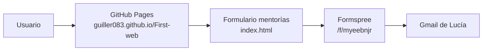

# Arquitectura

Sitio estático sin build ni backend propio: HTML + CSS + JS servidos por GitHub Pages. Los únicos servicios externos son Formspree (formulario) y Google Fonts (tipografía).

## Formulario de mentorías (Formspree)

- **Ubicación:** sección `#mentoring`, dentro de `.mentoring-form-row > .form-wrap` (`index.html`).
- **Endpoint:** `action="https://formspree.io/f/myeebnjr"`, `method="POST"`.
- **Email receptor:** se configura en el dashboard de Formspree (*Settings → Target email*), **no en el código**.
- **Campos:** `name`, `email`, `type` (select: athlete/club/company/other), `message`, `consent` (checkbox), `_gotcha` (honeypot oculto anti-spam, `.hp-field` fuera de pantalla).
- **Flujo de envío:** `js/main.js` intercepta el `submit`, valida con `reportValidity()` y hace `fetch` con `Accept: application/json`; muestra confirmación o error en `#mf-status`. Sin JS, el formulario hace un POST nativo al mismo endpoint (fallback).

## Dominio y despliegue

- **Hosting:** GitHub Pages, rama `main`, carpeta `/ (root)`. `.nojekyll` desactiva el procesado de Jekyll.
- **Dominio:** comprado en Namecheap. GitHub genera el archivo `CNAME` en el repo al configurar el dominio en *Settings → Pages*.
- **DNS (Namecheap):**
  - 4 registros `A` hacia las IPs de GitHub Pages: `185.199.108.153`, `185.199.109.153`, `185.199.110.153`, `185.199.111.153`.
  - `CNAME` de `www` → `guiller083.github.io`.
- **HTTPS:** gestionado por GitHub con Let's Encrypt (opción *Enforce HTTPS* en Settings → Pages).

## Flujo

## Nota de seguridad

El repo es público: no incluir credenciales, API keys ni datos sensibles en el código. Todo lo publicado aquí es visible por cualquiera.
